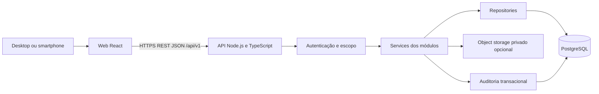
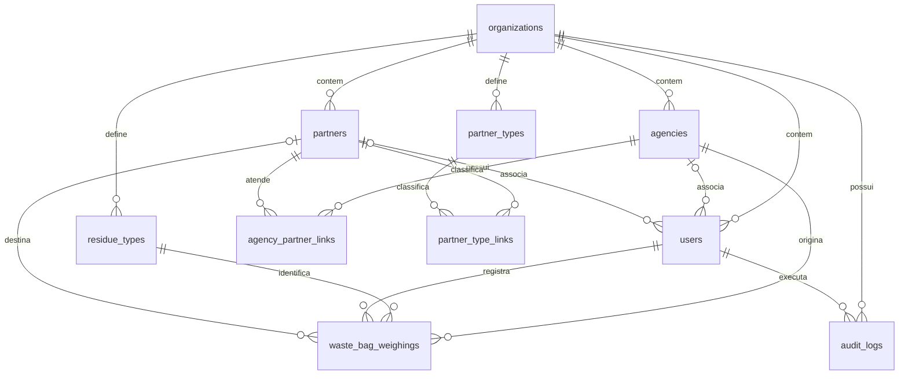

# Spec da arquitetura geral do MVP Lixo Zero Sicredi

Data: 07/11/2026. Esta é a spec de referência. O usuário autorizou posteriormente implementar somente o backend; o estado efetivo da implementação e as políticas ainda pendentes estão em `STATUS_BACKEND.md`. O esqueleto do frontend foi autorizado posteriormente e está descrito em `STATUS_FRONTEND.md`; a referência visual foi fornecida posteriormente e sua aplicação está documentada em `REFERENCIA_VISUAL.md`.

## 1. Base e alcance

Esta spec traduz a arquitetura funcional e técnica do documento de referência, versão 1.0 de 02/11/2026, para React JS, Node.js com TypeScript, PostgreSQL e Docker, conforme decisão do usuário. O contexto completo, as regras e as exclusões estão em `../AGENT.md`.

O produto registra um saco por pesagem, consolida resultados e controla acesso por organização, agência e parceiro. O primeiro incremento entrega o caminho login, cadastros essenciais, pesagem, histórico e dashboard da agência. O MVP completo inclui os demais perfis, cadastros, dashboard geral, relatórios e auditoria. Bombonas, QR Code e ordem de transporte não serão criados.

As escolhas abaixo marcadas como propostas detalham a implementação sem alterar o escopo funcional. Pendências de negócio não devem ser preenchidas silenciosamente durante o desenvolvimento.

## 2. Visão geral

Proposta: monorepositório simples com dois aplicativos e banco compartilhado com isolamento lógico por organização. Backend como monólito modular, evitando complexidade operacional desnecessária no MVP.



O navegador nunca acessa o banco. A API é responsável por autenticação, autorização, validações, cálculos e auditoria. Docker Compose organiza `web`, `api` e `db` no desenvolvimento; object storage é um serviço opcional quando o upload for ativado. Uma origem pública única com proxy para `/api` simplifica cookies e implantação; essa é uma proposta de operação.

## 3. Decisões técnicas propostas

| Camada | Proposta | Finalidade |
| --- | --- | --- |
| Web | React JS com Vite e JavaScript | SPA responsiva; TypeScript foi exigido para a API, não para a web |
| Navegação | React Router | Rotas e layouts por perfil |
| Dados remotos | TanStack Query | Cache de consultas e invalidação após mutações |
| API | Node.js com TypeScript e Express | Rotas, middlewares e controllers explícitos |
| Validação | Zod | DTOs e configuração validados na entrada |
| Persistência | Prisma com migrations SQL complementares | Acesso tipado e versionamento do schema |
| Banco | PostgreSQL | Relações, transações, NUMERIC, TIMESTAMPTZ e JSONB |
| Sessão | Identificador opaco em cookie e sessão persistida no servidor | Logout revogável e controle de sessão |
| Senhas | Argon2id | Hash forte conforme documento |
| Contrato | OpenAPI | Documentar payloads, respostas, filtros e permissões |
| Infraestrutura | Docker e Docker Compose | Ambiente local reproduzível e base de homologação |
| Testes | Vitest, testes HTTP e PostgreSQL de teste; Playwright no fluxo principal | Validar regras, isolamento e jornada mobile |

Nenhuma dependência ou versão foi instalada nesta etapa. Ao iniciar a implementação, selecionar versões suportadas e compatíveis e fixá-las no lockfile e nas imagens. A escolha de biblioteca visual permanece aberta; não é requisito funcional.

## 4. Estrutura de pastas planejada

```text
/
├── AGENT.md
├── AGENTS.md
├── docs/
│   └── SPEC_ARQUITETURA.md
├── compose.yaml
├── .env.example
├── .gitignore
├── web/
│   ├── Dockerfile
│   ├── package.json
│   ├── public/
│   └── src/
│       ├── app/              # inicialização, providers e roteamento
│       ├── pages/            # telas por funcionalidade
│       ├── components/       # componentes reutilizáveis
│       ├── layouts/          # layouts por contexto de navegação
│       ├── services/         # cliente HTTP e chamadas da API
│       ├── hooks/            # sessão e consultas
│       ├── utils/
│       └── styles/
└── api/
    ├── Dockerfile
    ├── package.json
    ├── tsconfig.json
    ├── prisma/
    │   ├── schema.prisma
    │   ├── migrations/
    │   └── seed.ts
    ├── tests/
    │   ├── integration/
    │   └── unit/
    └── src/
        ├── app.ts
        ├── server.ts
        ├── config/
        ├── routes/
        ├── controllers/
        ├── services/
        ├── repositories/
        ├── validators/
        ├── middlewares/
        ├── policies/
        ├── types/
        ├── errors/
        └── utils/
```

Esta árvore descreve o estado futuro, não arquivos já implementados. Usar arquivos nomeados por domínio em cada camada, por exemplo `routes/weighings.routes.ts`, `controllers/weighings.controller.ts`, `services/weighings.service.ts`, `repositories/weighings.repository.ts` e `validators/weighings.validator.ts`. A organização por camadas atende à estrutura solicitada; os domínios permanecem módulos lógicos.

Fluxo de requisição: rota → autenticação → validação → policy/service → repository → PostgreSQL. Controllers traduzem entrada e saída HTTP. Services aplicam regras e delimitam transações. Repositories recebem contexto de escopo obrigatório e usam consultas parametrizadas. Policies são reutilizadas por todas as operações do domínio; não limitar a autorização às rotas ou à UI.

## 5. Domínios e responsabilidades

| Domínio | Responsabilidade |
| --- | --- |
| auth | Login, logout, sessão, recuperação simplificada a definir |
| organizations | Tenant e configuração da organização |
| agencies | Cadastro e status de agências |
| users | Usuários, perfis, associações e status |
| partners | Parceiros, tipos e vínculos operacionais |
| residue-types | Tipos e parâmetros de resíduos |
| weighings | Criação, consulta, correção e cancelamento |
| dashboard | Agregados com o mesmo escopo das pesagens |
| reports | Consulta e CSV com os mesmos critérios dos indicadores |
| audit | Trilha das alterações e consulta autorizada |

## 6. Identidade e isolamento

Cada requisição autenticada recebe contexto gerado pelo servidor: `user_id`, `organization_id`, `role`, `agency_id` e `partner_id`. Validar usuário e sessão ativos. Nunca aceitar `organization_id`, `registered_by` ou perfil enviados pelo cliente como fonte de autoridade.

Super Admin seleciona uma agência da sua organização ao registrar pesagem. Para usuários de agência, o servidor deriva a agência da identidade. Para parceiros, as consultas usam o parceiro autenticado e somente os registros relacionados cuja visualização esteja habilitada. A visibilidade entre agências atendidas pelo mesmo parceiro precisa seguir política explícita de campos e dados.

Toda listagem, busca por ID, atualização, vínculo, agregado, exportação e acesso a arquivo aplica esse contexto. IDs válidos de outro escopo não podem revelar a existência ou o conteúdo do recurso. Proposta: devolver 404 para recurso fora do escopo; 403 para operação proibida sobre recurso acessível.

Além de RBAC, verificar propriedade e relacionamentos: pertencer à mesma agência, ser autor, estar dentro da janela permitida e relacionar-se ao parceiro. Não permitir que administradores deleguem perfis ou mudem associações para ampliar seus próprios privilégios.

Proposta de sessão: cookie `HttpOnly`, `Secure` nos ambientes HTTPS e `SameSite=Lax`; expiração e revogação no servidor. Adicionar tabela técnica `sessions`, com referência ao usuário, hash do identificador e timestamps, sem alterar as entidades funcionais. Proteger operações mutáveis contra CSRF e restringir CORS às origens configuradas. Não armazenar credenciais em localStorage. Recuperação de senha exige fluxo e canal a definir; não pressupor integração de e-mail.

## 7. Modelo relacional e integridade

Preservar as dez entidades funcionais e todos os campos descritos no AGENT.md. Acrescentar timestamps técnicos onde úteis. Usar UUID nas entidades, chaves estrangeiras e índices de escopo.



Propostas de integridade:

- `CHECK (weight_kg > 0)` e `NUMERIC(10,3)`; rejeitar precisão excedente em vez de arredondar silenciosamente.
- `TIMESTAMPTZ` para instantes; persistência e processamento coerentes em UTC, apresentação no fuso configurado. Intervalos de relatório devem declarar fuso e limites.
- Relações compostas que incluam `organization_id` para impedir vínculos entre tenants, com constraints SQL quando necessário. Adicionar `organization_id` às tabelas de vínculo para facilitar essa integridade.
- Chaves únicas nos pares de vínculos e em `(organization_id, code)` de agência. Escopos de unicidade de documentos/e-mail dependem de decisão específica.
- Constraints de associação coerentes com o perfil: usuário central sem agência/parceiro, usuário interno com agência, usuário externo com parceiro. Confirmar se haverá múltiplas associações antes de ampliar o modelo.
- Índices iniciais de pesagens em `(organization_id, agency_id, weighed_at)` e `(organization_id, destination_partner_id, weighed_at)`; avaliar índices de resíduo/status pelas consultas reais.
- Não usar exclusão em cascata que apague histórico operacional ou auditoria. Inativar cadastros preservando referências e registros anteriores.
- Auditoria administrativa inclui alterações de status e permissões. Redigir snapshots por lista de campos permitidos, omitindo hash de senha, segredos e dados pessoais desnecessários.

### Semântica de correção pendente

A fonte define status `active`, `corrected`, `cancelled`, mas calcula indicadores sobre ativos. Não esclarece se uma pesagem corrigida continua compondo o total. A interpretação deve ser decidida antes da implementação.

Proposta para avaliação: manter o mesmo ID, gravar os valores vigentes com status `corrected`, guardar o antes/depois na auditoria e incluir `active` e `corrected` nos indicadores operacionais. Isso evita perder o peso após uma correção, mas adapta a formulação literal dos indicadores e precisa de confirmação. Até a decisão, não tratar essa proposta como requisito aprovado nem implementar uma versão alternativa por substituição de registros.

## 8. Contratos da API

Prefixo comum `/api/v1`; JSON, autenticação e escopo em todos os recursos privados.

| Método | Recurso | Contrato funcional |
| --- | --- | --- |
| POST | /auth/login | Autenticar e criar sessão |
| POST | /auth/logout | Revogar sessão |
| GET | /me | Identidade e permissões efetivas |
| GET, POST | /agencies | Listar e criar no escopo |
| GET, PATCH | /agencies/{id} | Detalhe e manutenção |
| GET, POST | /users | Listar e criar no escopo |
| GET, PATCH | /users/{id} | Detalhe e manutenção |
| GET, POST | /partners | Listar e criar |
| GET, PATCH | /partners/{id} | Detalhe e manutenção |
| GET, POST | /residue-types | Listar e criar |
| GET, PATCH | /residue-types/{id} | Detalhe e manutenção |
| GET, POST | /weighings | Histórico e registro |
| GET, PATCH | /weighings/{id} | Detalhe e correção permitida |
| POST | /weighings/{id}/cancel | Cancelamento lógico |
| GET | /dashboard/summary | Agregados conforme escopo |
| GET | /reports/weighings | Relatório filtrado |
| GET | /audit-logs | Auditoria autorizada |

Complementos propostos para viabilizar funções previstas: `/partner-types` e `/partner-types/{id}` com GET/POST e GET/PATCH; rotas de manutenção de vínculos entre agências e parceiros e entre parceiros e tipos; PATCH `/me` e endpoint próprio para troca de senha; consulta/manutenção de `/organization` pelo Super Admin; GET `/weighings/{id}/audit-logs` ou filtro equivalente em auditoria. Não fornecer cadastro público de tenants ou usuários. A forma final desses complementos será registrada no OpenAPI antes de codificá-los.

Filtros mínimos de pesagens: `start_date`, `end_date`, `agency_id`, `residue_type_id`, `registered_by`, `destination_partner_id`, `status`, `page`, `page_size`, `sort`. Proposta: paginação padrão 20, limite 100 e ordenação com lista permitida e desempate por ID. Filtros nunca ampliam o escopo. Relatórios usam filtros equivalentes e CSV via formato negociado/documentado; proteger células contra fórmulas de planilha.

Payload funcional, seguindo o anexo A da fonte:

```json
{
  "residue_type_id": "uuid-do-tipo",
  "weight_kg": 8.750,
  "weighed_at": "2026-11-02T19:40:00-04:00",
  "destination_partner_id": "uuid-do-parceiro-opcional",
  "notes": "Saco coletado no setor administrativo"
}
```

`weighed_at` é omitido no fluxo comum e preenchido pelo servidor; quando enviado, exige permissão específica. O payload do Super Admin precisa de `agency_id` validado. `registered_by` e tenant são sempre derivados. Omitir ou enviar `null` nos campos opcionais conforme contrato documentado. Proposta: serializar pesos de resposta como string decimal, evitando perda de precisão em somas JavaScript; converter para decimal no backend e manter o formato de entrada acima.

Propostas de resposta: 201 na criação, 200 nas consultas/correções, 204 no logout; 400 para entrada inválida, 401 para sessão ausente, 403 para ação proibida, 404 para recurso inacessível/inexistente, 409 para conflito. Envelope de erro `{ "error": { "code": "...", "message": "...", "fields": {} }, "request_id": "..." }`; listagens `{ "data": [], "pagination": { "page": 1, "page_size": 20, "total": 0 } }`. Não expor stack traces ou segredos.

## 9. Escrita de pesagens e auditoria

Criação: resolver identidade e agência → validar autorização e DTO → conferir resíduo/parceiro/escopo → obter horário padrão do servidor → iniciar transação → inserir pesagem → inserir auditoria → confirmar. Se a auditoria falhar, reverter a escrita. Cadastros administrativos relevantes seguem o mesmo princípio.

Correção: carregar registro no escopo, conferir campos autorizados e janela, preservar autoria original, gravar antes/depois e autor da correção. Proposta: controle otimista com versão técnica para rejeitar correções concorrentes com 409; não sobrescrever silenciosamente.

Cancelamento: conferir política, marcar `cancelled` e auditar em transação. Não apagar. Definir se motivo é obrigatório e se repetição retorna sucesso sem duplicar evento. Não presumir reativação de canceladas.

No frontend, desabilitar envio durante a requisição e invalidar histórico, detalhe e dashboard após sucesso. Os indicadores consultam o banco atualizado, sem pipeline assíncrono ou cache persistente no primeiro incremento. Repetições por falha de rede exigem política de idempotência se forem suportadas; não assumir entrega única apenas pelo botão desabilitado.

## 10. Evidências opcionais

Quando ativadas, fotos são armazenadas em bucket privado S3/R2/MinIO ou equivalente. Proposta: `evidence_url` guarda uma referência estável ao objeto, nunca URL pública permanente ou URL assinada expirada. A API autoriza upload e leitura conforme o escopo da pesagem e gera acesso temporário.

Validar tamanho e tipo real do arquivo, gerar chave no servidor e remover uploads órfãos por rotina definida. Limites, formatos e retenção devem ser decididos antes da ativação. Sem upload no primeiro incremento, o fluxo continua válido e o campo permanece nulo; o recurso continua no planejamento do MVP.

## 11. Frontend e navegação

Login e sessão primeiro. Layout autenticado apresenta navegação conforme permissões devolvidas por `/me`. Restrições visuais acompanham a API, que permanece responsável pela autorização.

Construir cadastros de agências, usuários, parceiros/tipos/vínculos e resíduos. Formulário mobile de pesagem mostra tipo e peso primeiro, agência do contexto e campos opcionais após os essenciais. Interpretar vírgula decimal da interface sem alterar a precisão de kg. Informar sucesso e atualizar dados depois da confirmação da API. Não incluir modo offline/PWA instalável como requisito obrigatório.

Histórico usa tabela no desktop e apresentação adequada no celular, com filtros, paginação e ações permitidas. Detalhe apresenta dados e trilha de alterações autorizada. Dashboards respeitam escopo: geral para Super Admin, agência para administrador e acesso limitado explicitamente configurado para colaboradores. Usuários de parceiro recebem consulta própria quando habilitada. Meu Perfil permite dados básicos e troca de senha conforme contrato.

## 12. Dashboards e relatórios

Agregações: peso total, peso por tipo/agência/período/parceiro, quantidade, média por saco e últimos lançamentos. Acrescentar contadores e ranking especificados para cada dashboard. Série diária, semanal ou mensal com limites de período claros. Pesagem cancelada é sempre excluída por padrão; inclusão de corrigidas depende da decisão da seção 7.

Histórico, dashboard e relatório devem compartilhar predicados de autorização e status para evitar divergências. CSV aplica o mesmo escopo de leitura e acesso mínimo a dados pessoais. Relatórios de auditoria podem incluir corrigidas/canceladas com filtro explícito e permissão adequada.

## 13. Docker e ambientes

Desenvolvimento: serviços `web`, `api` e `db`, com rede interna e volume persistente para PostgreSQL; segredos locais via ambiente e `.env` ignorado pelo Git. `.env.example` contém somente nomes e valores demonstrativos. Healthcheck distingue processo vivo de prontidão para atender com banco disponível. Migrations são etapa explícita, concluída antes de atender tráfego; seed é comando separado e restrito a DEV/HML.

Homologação: builds reproduzíveis, HTTPS, acesso por smartphone e dados de demonstração fictícios. Produção: banco sem exposição pública, secrets de implantação, backups automáticos e teste de restauração. Definir retenção e objetivos de recuperação antes de produção. Volumes locais de desenvolvimento não substituem backup.

Logs estruturados incluem request_id, resultado e duração, sem senha, token, CPF/CNPJ ou conteúdo livre de evidências. Auditoria de negócio é persistida separadamente dos logs técnicos. Não adicionar microsserviços, filas, Kubernetes ou integrações corporativas como pré-requisito.

## 14. Passos iniciais de construção

| Etapa | Entrega | Verificação para avançar |
| --- | --- | --- |
| 0 | Fechar políticas pendentes e contratos do primeiro incremento | Escopo, correção, autorização e identidade documentados |
| 1 | Inicializar web/api, TypeScript da API, Compose, configuração e healthchecks | Ambiente local inicia; configuração inválida falha claramente |
| 2 | Migrations do núcleo, constraints e seed fictício | Banco vazio migra; seed demonstra perfis e duas agências |
| 3 | Login/logout/me, sessão, policies e escopo obrigatório | Acesso negado sem sessão; logout revoga; isolamento validado |
| 4 | Cadastros essenciais, parceiros/tipos/vínculos e permissões | Cada perfil só mantém recursos autorizados |
| 5 | Registro mobile de um saco com auditoria transacional | Peso válido persiste; inválidos e relações externas são rejeitados |
| 6 | Histórico, detalhe, correção e cancelamento | Filtros e auditoria corretos, sem exclusão física |
| 7 | Dashboard agência e demonstração do primeiro incremento | Nova pesagem atualiza histórico e total; cancelamento retira peso |
| 8 | Dashboard geral, consultas de parceiros e relatórios/CSV | Consolidação e exportação respeitam cada escopo |
| 9 | Evidência opcional, perfil e recuperação conforme decisão; HML | Jornada em smartphone e critérios do MVP atendidos |

A prioridade visual segue a fonte: login → cadastros → pesagem → histórico/detalhe → dashboard agência → dashboard geral → relatórios. Segurança, migrations e auditoria acompanham cada entrega, não ficam para o final. A implementação do backend é acompanhada em `STATUS_BACKEND.md`; o esqueleto de frontend autorizado na etapa seguinte é acompanhado em `STATUS_FRONTEND.md`.

## 15. Validação e aceite

Preparar banco de teste com dois tenants, duas agências no tenant principal e parceiros relacionados e não relacionados. Testar cada perfil por chamadas HTTP diretas, incluindo troca de ID e manipulação de filtros e payloads. Provar que Super Admin não atravessa tenants e que Admin Agência/usuários externos não escapam dos vínculos permitidos.

Validar peso zero/negativo, precisão, tipo inativo, parceiro inativo/de outro tenant, campos opcionais, data padrão do servidor e tentativa de alterar data sem permissão. Testar transação e rollback caso a auditoria falhe. Correção deve preservar antes/depois; cancelamento deve manter o registro e removê-lo dos indicadores. Validar concorrência conforme estratégia adotada.

Usar dados conhecidos para conferir SUM, COUNT e AVG, agrupamentos, datas e filtros; relatórios devem coincidir com dashboard sob os mesmos critérios. Testar acesso a evidências quando ativadas. A jornada E2E precisa cobrir login → cadastro/seleção autorizada de agência → resíduo → pesagem → histórico → dashboard em desktop e smartphone.

O MVP só é aceito com todos os critérios do AGENT.md atendidos, incluindo gestão de parceiros e tipos, perfis, auditoria, relatórios e ausência de dependência de bombonas. O primeiro incremento utilizável é um marco intermediário, não a conclusão do MVP completo.

## 16. Decisões de negócio ainda necessárias

| Ponto deixado aberto pela fonte | O que precisa ser definido |
| --- | --- |
| Corrigidas nos indicadores | Semântica de `corrected` e relação com o cálculo apenas de ativos |
| Edição | Janela, campos, perfis e tratamento de canceladas |
| Cancelamento | Perfis autorizados, motivo, repetição e eventual reversão |
| Ajuste de data/hora | Perfis, retroatividade e datas futuras permitidas |
| Consulta do colaborador interno | Próprios registros ou quais registros da agência e quais indicadores |
| Acesso de parceiros | Habilitação, campos visíveis, limites do colaborador e dados de agências |
| Admin Agência e parceiros | Cadastro versus vínculo de parceiro existente, manutenção de dados compartilhados e cadastro de usuários externos |
| Vínculo agência/parceiro na pesagem | Validação obrigatória ou apenas mesmo tenant e parceiro ativo |
| Unicidade | Escopo de CPF, CNPJ e e-mail; tenant no login se e-mail não for globalmente único |
| Documentos e perfil | Obrigatoriedade dos campos, alterações permitidas e minimização de dados |
| Sessão e recuperação | Expiração, canal e procedimento de recuperação simplificada |
| Evidências e operação | Primeiro incremento com foto ou posterior; limites, retenção, fuso de relatórios e política de backups |

Esses pontos não impedem preparar o ambiente e o esqueleto quando a construção for solicitada. O comportamento correspondente só deve ser implementado após sua definição; propostas técnicas não concedem permissões de negócio por padrão.
